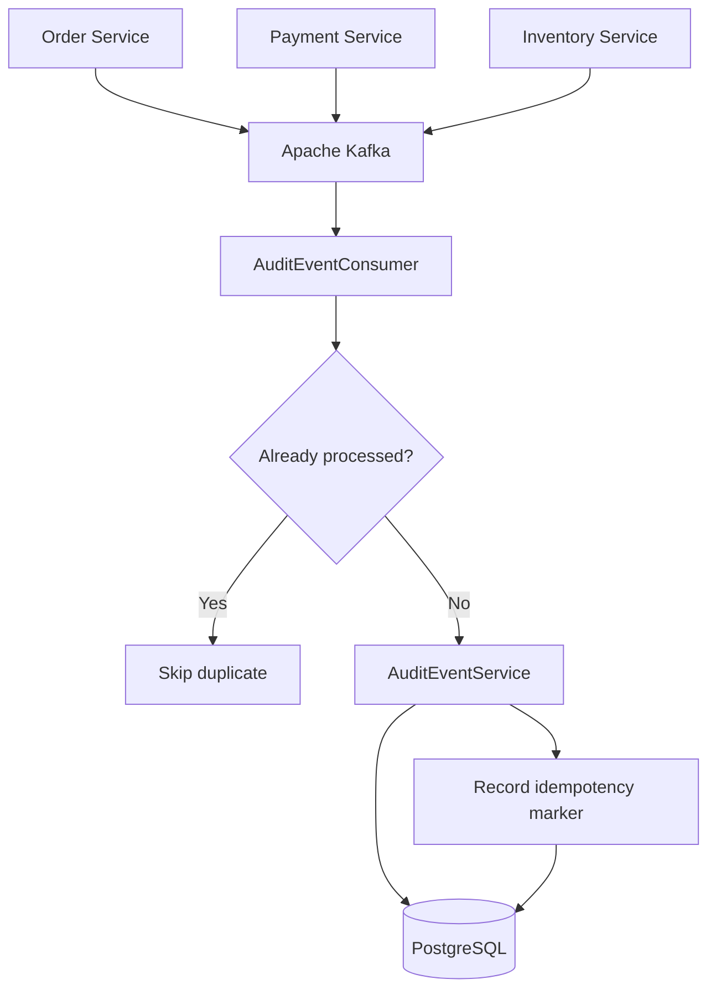

# Order Audit Service

**Event-Driven Audit Logging Microservice | Spring Boot 4 • Java 21 • Apache Kafka • PostgreSQL**

Order Audit Service is a standalone microservice responsible for capturing, storing, and querying audit events generated by other microservices in an event-driven order management system.

It consumes business events from Apache Kafka, persists structured audit records in PostgreSQL, and implements database-backed idempotency to prevent duplicate event processing.

The service provides a centralized, reliable, and traceable audit history across distributed services.

## Key Features

- **Event-Driven Architecture:** Consumes business events asynchronously using Apache Kafka.
- **Centralized Audit Logging:** Maintains structured audit records for business operations.
- **Idempotent Event Processing:** Prevents duplicate processing using event identifiers and consumer names.
- **PostgreSQL Persistence:** Stores audit metadata and event payloads using PostgreSQL JSONB.
- **Transactional Processing:** Coordinates audit persistence and idempotency tracking within database transactions.
- **Event Traceability:** Tracks event ID, event type, source service, aggregate, and occurrence timestamp.
- **Flexible Audit Queries:** Supports filtering by aggregate, event type, source service, and timestamp ranges.
- **Pagination:** Provides paginated audit queries using Spring Data JPA.
- **Integration Testing:** Uses Testcontainers, JUnit 5, and Awaitility to test asynchronous Kafka processing and PostgreSQL persistence.

## Technology Stack

| Technology | Purpose |
|---|---|
| Java 21 | Programming language |
| Spring Boot 4 | Microservice framework |
| Spring Kafka | Kafka producer/consumer integration |
| Apache Kafka | Asynchronous event messaging |
| PostgreSQL | Relational audit database |
| PostgreSQL JSONB | Structured event payload storage |
| Spring Data JPA | Database persistence |
| Hibernate | ORM implementation |
| Jackson | JSON serialization/deserialization |
| Maven | Build and dependency management |
| JUnit 5 | Automated testing |
| Testcontainers | PostgreSQL and Kafka integration testing |
| Awaitility | Asynchronous testing |
| AssertJ | Fluent assertions |

## System Architecture

The audit service operates as part of a distributed order-processing system.



The currently implemented consumer handles `OrderCreatedEvent`. Additional business event subscriptions can be introduced as the audit service evolves.

## Project Structure

```text
order-audit-service/
│
├── README.md
├── pom.xml
│
└── src/
    ├── main/
    │   ├── java/
    │   │   └── com/orders/
    │   │       ├── AuditServiceApplication.java
    │   │       │
    │   │       └── audit/
    │   │           ├── common/
    │   │           │   └── events/
    │   │           │
    │   │           ├── config/
    │   │           │   ├── JacksonConfig.java
    │   │           │   ├── KafkaAuditEventConusomerConfig.java
    │   │           │   └── KafkaConfig.java
    │   │           │
    │   │           ├── controller/
    │   │           │
    │   │           ├── domain/
    │   │           │   └── model/
    │   │           │       └── AuditEvent.java
    │   │           │
    │   │           ├── idempotency/
    │   │           │   ├── IdempotencyService.java
    │   │           │   ├── ProcessedEvent.java
    │   │           │   └── ProcessedEventRepository.java
    │   │           │
    │   │           ├── kafka/
    │   │           │   └── consumer/
    │   │           │       └── AuditEventConsumer.java
    │   │           │
    │   │           ├── repository/
    │   │           │   └── AuditEventRepository.java
    │   │           │
    │   │           └── service/
    │   │               ├── AuditEventService.java
    │   │               └── impl/
    │   │                   └── AuditEventServiceImpl.java
    │   │
    │   └── resources/
    │       └── application.yml
    │
    └── test/
        └── java/
            └── com/orders/audit/
                ├── kafka/consumer/
                │   └── AuditEventConsumerIntegrationTest.java
                └── service/
                    └── AuditEventServiceImplTest.java
```

*The structure normalizes package names and includes conventional Maven directories. Adjust filenames and configuration paths to match the repository.*

## Event Processing Workflow

### 1. Event Publication

The Order Service publishes an `OrderCreatedEvent` to the Kafka topic:

`order.created`

Example event payload:

```json
{
  "eventId": "b25f61d3-0e13-49a2-8a1f-84539d6cc7f1",
  "eventType": "order.created",
  "occurredAt": "2026-10-14T08:00:00Z",
  "orderId": "32b5f38a-2d9c-4c6d-945b-998b1a5d26a7",
  "orderNumber": "ORD-2026-1001",
  "customerId": "8f42b6e0-06e3-43b7-83f6-fdc4c83b2211",
  "totalAmount": 125.00,
  "currency": "QAR",
  "items": []
}
```

### 2. Kafka Event Consumption

`AuditEventConsumer` subscribes to the configured Kafka topic and processes incoming events.

Responsibilities include:

- Receiving Kafka messages.
- Deserializing event payloads.
- Extracting event metadata.
- Checking whether an event has already been processed.
- Delegating audit persistence to the service layer.

### 3. Idempotency Validation

Before persisting an audit event, the service checks whether the combination of `eventId` and `consumerName` already exists in the processed events table.

```java
if (idempotencyService.alreadyProcessed(
        event.eventId(),
        CONSUMER_NAME)) {
    return;
}
```

This protects the audit service against duplicate event processing.

### 4. Audit Persistence

New events are transformed into `AuditEvent` entities and persisted to PostgreSQL.

Each audit record contains:

| Field | Description |
|---|---|
| event_id | Unique event identifier |
| event_type | Business event type |
| source_service | Originating microservice |
| aggregate_type | Business aggregate category |
| aggregate_id | Associated aggregate identifier |
| occurred_at | Original event timestamp |
| recorded_at | Audit recording timestamp |
| payload | Original JSON event data |

### 5. Idempotency Marker

After the audit event is successfully persisted, the event identifier and consumer name are recorded in the processed events table.

Audit persistence and idempotency marker creation should be committed atomically in the same database transaction.

## Database Design

### audit_events

Stores the history of consumed business events.

```sql
CREATE TABLE audit_events (
    event_id UUID PRIMARY KEY,
    event_type VARCHAR(100) NOT NULL,
    source_service VARCHAR(100) NOT NULL,
    aggregate_type VARCHAR(100) NOT NULL,
    aggregate_id VARCHAR(255) NOT NULL,
    occurred_at TIMESTAMPTZ NOT NULL,
    recorded_at TIMESTAMPTZ NOT NULL DEFAULT NOW(),
    payload JSONB NOT NULL
);
```

### audit_processed_events

Tracks processed Kafka messages for idempotency.

```sql
CREATE TABLE audit_processed_events (
    id UUID PRIMARY KEY,
    event_id UUID NOT NULL,
    consumer_name VARCHAR(150) NOT NULL,
    processed_at TIMESTAMPTZ NOT NULL DEFAULT NOW(),
    CONSTRAINT uk_audit_processed_event
        UNIQUE (event_id, consumer_name)
);
```

These SQL definitions illustrate the intended schema. The actual migrations should match the entity mappings and repository queries in the application.

## Audit Query Capabilities

The service layer supports retrieving audit records using several criteria.

| Query | Description |
|---|---|
| `getByEventId()` | Find an audit event by its event ID |
| `getByAggregate()` | Retrieve events for a specific aggregate |
| `getByEventType()` | Filter events by business event type |
| `getBySourceService()` | Filter events by originating service |
| `getByOccurredAtBetween()` | Retrieve events within a timestamp range |
| `getByAggregateAndOccurredAtBetween()` | Retrieve aggregate events within a timestamp range |

Spring Data pagination is used to efficiently query larger audit histories.

These are service-level capabilities; REST endpoints depend on the implementation of the controller layer.

## Getting Started

### Prerequisites

Ensure the following tools are available:

- Java Development Kit 21
- Maven 3.9+
- Docker and Docker Compose
- PostgreSQL
- Apache Kafka

### 1. Clone the Repository

```bash
git clone https://github.com/waliedAfro/order-audit-service.git

cd order-audit-service
```

### 2. Start Infrastructure

Start the Kafka and PostgreSQL infrastructure using your Docker Compose configuration.

For example, if the infrastructure is maintained in a separate repository:

```bash
cd order-kafka-docker

docker compose up -d
```

Ensure that the Kafka topic `order.created` exists and that PostgreSQL is accessible.

### 3. Configure Application Properties

Example `application.yml`:

```yaml
spring:
  application:
    name: order-audit-service

  datasource:
    url: jdbc:postgresql://localhost:5432/audit_db
    username: ${DB_USERNAME}
    password: ${DB_PASSWORD}

  kafka:
    bootstrap-servers: localhost:29092

    consumer:
      group-id: audit-service
      auto-offset-reset: earliest

    topics:
      order-created: order.created
```

The actual Kafka deserializer settings should match the implementation of `KafkaAuditEventConusomerConfig`.

### 4. Build the Application

```bash
mvn clean package
```

### 5. Run the Service

```bash
mvn spring-boot:run
```

Alternatively, run the packaged JAR:

```bash
java -jar target/order-audit-service-*.jar
```

## Testing

The service includes automated tests covering database persistence, audit queries, Kafka consumption, and idempotency.

### Service Tests

`AuditEventServiceImplTest` validates:

- PostgreSQL connectivity.
- Audit event persistence.
- Event retrieval by identifier.
- Duplicate event handling.
- Filtering by event type.
- Filtering by source service.
- Aggregate-based queries.
- Timestamp range queries.
- Pagination.

### Kafka Integration Tests

`AuditEventConsumerIntegrationTest` validates the interaction between:

1. Apache Kafka.
2. Spring Kafka consumers.
3. Audit event processing.
4. PostgreSQL persistence.
5. Database-backed idempotency.

Integration tests use real Kafka and PostgreSQL containers through Testcontainers.

Awaitility verifies asynchronous processing without relying on fixed thread sleeps.

### Run All Tests

```bash
mvn clean test
```

### Run Kafka Integration Tests

```bash
mvn -Dtest=AuditEventConsumerIntegrationTest test
```

### Run Audit Service Tests

```bash
mvn -Dtest=AuditEventServiceImplTest test
```

### Latest Verified Kafka Integration Test Result

```text
Tests run: 3
Failures: 0
Errors: 0
Skipped: 0

BUILD SUCCESS
```

## Reliability and Data Consistency

The audit service follows several important reliability principles.

**At-least-once delivery:** Kafka messages may be delivered more than once, especially after consumer failures or rebalances.

**Idempotency:** Processed event identifiers are recorded to prevent duplicate audit records.

**Database uniqueness:** Unique constraints protect audit event identifiers and processed event markers.

**Transactional consistency:** Audit record creation and idempotency marker persistence should occur within one database transaction.

**Failure handling:** Processing exceptions should propagate to the Kafka listener error-handling mechanism so failed messages can be retried or handled according to the configured policy.

These mechanisms provide a foundation for reliable audit processing, although operational guarantees depend on the final consumer acknowledgment, retry, and transaction configurations.

## Future Enhancements

Potential improvements include:

- Support for `PaymentCompletedEvent` and `PaymentFailedEvent`.
- Support for `InventoryReservedEvent` and `InventoryReservationFailedEvent`.
- Dead-letter topic handling for permanently failing events.
- Configurable retry and exponential backoff policies.
- REST endpoints for searching audit history.
- Audit query filtering by order number and customer ID.
- OpenAPI documentation.
- Metrics and monitoring using Spring Boot Actuator and Micrometer.
- Distributed tracing with OpenTelemetry.
- Integration with centralized log management.
- Audit retention and archival policies.
- Role-based access control for audit queries.

## Related Microservices

This service is part of an event-driven order management ecosystem.

| Service | Responsibility |
|---|---|
| Order Service | Order creation and lifecycle management |
| Payment Service | Payment processing and payment events |
| Inventory Service | Stock management and reservations |
| Audit Service | Centralized audit logging and traceability |
| Kafka Infrastructure | Event transport and messaging |

Related repositories:

- [Order Service](https://github.com/waliedAfro/order-service)
- [Payment Service](https://github.com/waliedAfro/order-payment-service)
- [Inventory Service](https://github.com/waliedAfro/spring-boot-order-inventory-service)
- [Kafka Docker Infrastructure](https://github.com/waliedAfro/order-kafka-docker)

## Engineering Concepts Demonstrated

This project demonstrates practical implementation of:

- Event-driven microservices.
- Apache Kafka consumer integration.
- Database-backed idempotency.
- Transactional persistence.
- Distributed systems reliability.
- PostgreSQL JSONB storage.
- Clean service and repository separation.
- Asynchronous integration testing.
- Testcontainers-based testing.
- Spring Boot microservice development.

## Author

**Elwalied Elnour**

Backend Software Engineer | Java | Spring Boot | Microservices | Apache Kafka | PostgreSQL

GitHub: [waliedAfro](https://github.com/waliedAfro)

---

*Built as part of an enterprise-style event-driven order management system, with a focus on reliable event processing, data integrity, and audit traceability.*
